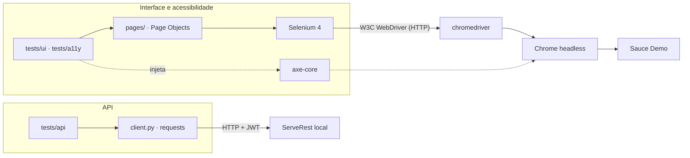

# QA Selenium Lab

[](https://github.com/Patrickfgf/qa-selenium-lab/actions/workflows/ci.yml)

Laboratório pessoal de estudo de automação de testes: interface web com **Selenium 4 + pytest**, API REST com **requests + JSON Schema** e acessibilidade com **axe-core** e navegação por teclado, rodando no **GitHub Actions** a cada mudança.

**Status:** as quatro etapas estão concluídas: esqueleto e CI; Page Objects, plano de teste e relatórios de bug; testes de API; acessibilidade. O que ainda não cobre está no fim desta página.

## Por onde ler em cinco minutos

1. **Um fluxo de ponta a ponta:** [`tests/ui/test_checkout.py`](tests/ui/test_checkout.py), a compra de dois produtos. O total é conferido somando em `Decimal` os preços que a própria tela mostra.
2. **Um Page Object:** [`pages/inventory_page.py`](pages/inventory_page.py). O localizador fica guardado como tupla, o construtor espera a página desenhar, e o XPath acha o botão pelo nome do produto.
3. **Um bug e o teste que o prende:** o BUG-006 em [`BUGS.md`](BUGS.md) e [`tests/a11y/test_keyboard.py`](tests/a11y/test_keyboard.py). O axe-core não acusa nada na página, e o teste de teclado mostra que o carrinho não recebe foco.
4. **Uma decisão:** a §8 de [`docs/DECISIONS.md`](docs/DECISIONS.md), sobre bug conhecido como `xfail(strict=True)` e por que o `raises=` precisa de um tipo diferente das outras falhas.
5. **A evidência de uma falha:** o artefato `test-report` de uma execução recente do [CI](https://github.com/Patrickfgf/qa-selenium-lab/actions/workflows/ci.yml), com o screenshot e o HTML de cada teste de bug conhecido (o artefato fica 14 dias).

## O que existe hoje

- `pages/`: um Page Object por tela do Sauce Demo (login, catálogo, carrinho e os três passos do checkout), mais o cabeçalho como componente. As esperas comuns ficam em `pages/base_page.py`.
- `tests/ui/`: login (tabela de decisão), logout, ordenação, compra completa, validação do checkout (partição de equivalência) e os usuários que simulam bloqueio, defeitos e lentidão.
- `tests/api/`: login, cadastro e permissão de rota no [ServeRest](https://serverest.dev/), uma API REST de estudo que roda localmente: token JWT, 401 contra 403, 400 com erro por campo e contrato validado com JSON Schema (`tests/api/schemas/`).
- `tests/a11y/`: regras WCAG 2.x A e AA do [axe-core](https://github.com/dequelabs/axe-core) no login, no catálogo, no carrinho e no checkout, e o uso só pelo teclado (ordem do Tab, login com Enter, controles alcançáveis).
- `tests/conftest.py`: Chrome novo por teste (headless por padrão); em falha, ou em bug conhecido, salva o screenshot e o HTML da página em `screenshots/`.
- [`TEST_PLAN.md`](TEST_PLAN.md): o que a suíte cobre e por quê, o que fica manual e como separo defeito de teste instável.
- [`BUGS.md`](BUGS.md): seis defeitos encontrados (cinco na interface, um na API), cada um com um teste `xfail(strict=True)` que o reproduz.
- [`docs/DECISIONS.md`](docs/DECISIONS.md): as escolhas que mudam o comportamento da suíte, com a alternativa descartada.
- `.github/workflows/ci.yml`: lint, formatação e testes a cada mudança; o relatório e a evidência ficam como artefato da execução.

## Como as peças conversam



Cada comando do Selenium é um pedido HTTP ao chromedriver, por isso toda espera é explícita (`WebDriverWait`). Os testes de API não abrem navegador: conferem status, corpo e contrato direto no ServeRest, que sobe dentro do job do CI.

## Como rodar

Pré-requisitos: [uv](https://docs.astral.sh/uv/), Google Chrome e Node.js (para o ServeRest e o axe-core). O Selenium Manager baixa o chromedriver sozinho.

```bash
uv sync --locked
npm ci --ignore-scripts      # axe-core, para os testes de acessibilidade
npx serverest@3.2.2          # em outro terminal: API em http://localhost:3000
uv run pytest                # suíte completa, headless
uv run pytest tests/ui       # só interface (sem a API, os testes de API são pulados com o motivo)
uv run pytest -m smoke       # só login e compra
uv run pytest -m a11y        # só acessibilidade
HEADLESS=0 uv run pytest     # com a janela do navegador visível
uv run ruff check && uv run ruff format --check
```

O relatório sai em `reports/report.html`.

## Localizadores

1. `data-test`, o atributo que o site expõe para teste, em seletor CSS: `[data-test="username"]`.
2. `id` quando o elemento certo não tem `data-test`. No menu, o `data-test` está no ícone, mas quem recebe o clique é o botão, então o alvo é `id="react-burger-menu-btn"`.
3. XPath só quando o CSS não alcança, que é ao casar texto: o botão "Add to cart" é encontrado pelo nome do produto do card. Nunca XPath por posição (`/div[3]/...`).

## O que este repo não cobre

- **Outros navegadores e Selenium Grid:** a fixture tem um ponto só onde o navegador é criado, então Firefox entraria ali. O Grid resolve escala que esta suíte não tem.
- **Acessibilidade com leitor de tela:** o axe-core e o teste de teclado cobrem só parte do que uma pessoa com deficiência encontra. Leitor de tela e o contraste que o axe deixa inconclusivo ficam manuais (`TEST_PLAN.md`).
- **Desempenho, mobile (Appium) e BDD:** fora do escopo deste laboratório.

## Stack

Python 3.12 · pytest · Selenium 4 · requests · jsonschema · axe-core · uv · ruff · GitHub Actions
